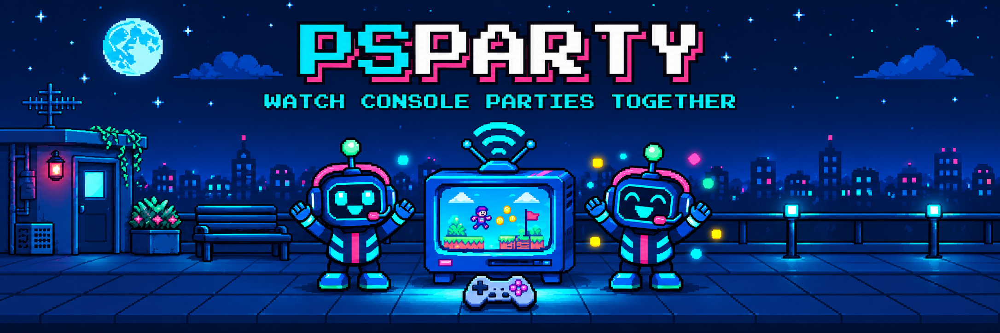

  

  <strong>Your console party. Right inside Discord.</strong>

  Watch PlayStation 5 party streams, keep talking with your friends and share
  your own console screen—all from a Discord voice channel.

  <a href="https://discord.com/oauth2/authorize?client_id=1569016831501668372">
    <strong>Open PSParty in Discord</strong>
  </a>
  ·
  <a href="https://psparty.xyz">
    <strong>Visit our website</strong>
  </a>

---

## What is PSParty?

PSParty is a Discord Activity that brings console parties and Discord closer together.

Start the Activity in your voice channel, connect your console account and enjoy your party together - without a capture card or complicated setup.

> [!IMPORTANT]
>
> Your privacy and security are a top priority for us. PSParty follows the principle of data minimization: we only process the limited account, session and technical information required to provide the requested features, maintain reliable operation, prevent misuse and protect our systems.
>
> We do not store your PlayStation password or your PlayStation account login credentials. PSParty never receives your password and cannot sign in using your personal login details. Access is restricted, sensitive components are separated and our security measures are continuously reviewed and improved.

### ✨ What’s inside

- 📺 **Watch together** — See PS5 party screen shares directly inside Discord.
- 🎮 **Share your console** — Let your friends watch your screen with just a few clicks.
- 🎙️ **Stay connected** — Keep talking in your Discord voice channel while everyone watches.
- ⚡ **No capture card** — Stream your console without additional hardware.
- 📱 **Desktop and mobile** — Join through Discord on your computer or phone.
- 🌍 **Regional streaming** — Regional media infrastructure provides a smooth, low-latency experience.

## PSParty is available now

The PSParty Activity is already available on Discord.

We are continuously improving the experience and would love to hear what you think. Every launch, stream and piece of feedback helps us make PSParty better.

  <a href="https://discord.com/oauth2/authorize?client_id=1569016831501668372">
    <strong>🚀 Try PSParty on Discord</strong>
  </a>

## How it works

1. Start PSParty from a Discord voice channel.
2. Connect your console account securely through Authframe.
3. Start Share Screen on your console.
4. Press **Share** inside PSParty and enjoy the party together.

## Feedback is welcome

PSParty is already available, and we would love for you to try it. Every launch, stream and piece of feedback helps us improve the experience.

Join our Discord community to share feedback, report issues, suggest new features or follow the latest PSParty updates.

  <a href="https://discord.psparty.xyz">
    <strong>💬 Join our Discord</strong>
  </a>

---

  <strong>Ready for the next round?</strong>  
  <a href="https://discord.com/oauth2/authorize?client_id=1569016831501668372">
    Open PSParty in Discord
  </a>

  
    PSParty is an independent, unofficial fan project. It is not affiliated
    with, endorsed by or sponsored by Sony Interactive Entertainment or Discord.
    All trademarks belong to their respective owners.
  

